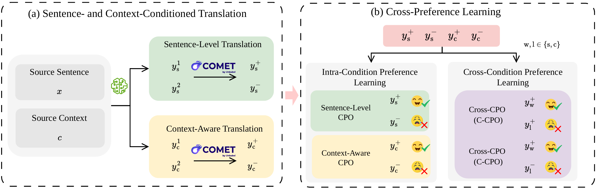

# ms-swift-CPL

[English](README.md) | **中文**



## 方法概览

**CPL** 在同一个模型中联合优化句子级翻译与上下文感知翻译。对于同一源句，分别在有、无上下文的条件下生成候选译文，并按翻译质量排序。**同条件偏好学习**区分各自条件内译文的优劣；**跨条件偏好学习**将最优候选与另一条件下的候选进行比较。两类信号共同帮助模型利用有益上下文，并在上下文无益时保持稳健，无需改变模型架构。

本项目基于 **ms-swift** 实现了完整的 **CPL（Cross-Preference Learning）** 训练流程，覆盖：

- SFT 训练
- 数据采样
- CPL 数据集构建
- CPL 训练 / 推理 / 评测

支持多卡 GPU 与 Deepspeed。

---

## 一、环境安装

```bash
# 创建并激活 Conda 环境
conda create -n mycpo python=3.10 -y
conda activate mycpo

# 安装 PyTorch（CUDA 12.4）
pip install torch==2.6.0 torchvision==0.21.0 torchaudio==2.6.0 --index-url https://download.pytorch.org/whl/cu124

# 基础依赖
conda install -c conda-forge pyarrow sentencepiece -y
pip install --upgrade pip

# 安装 ms-swift-CPL
cd ms-swift-CPL
pip install -e .

# 其他依赖
conda install -c conda-forge sentence -y
pip install deepspeed liger-kernel
pip install "vllm==0.8.5.post1"
```

## 二、整体流程（ms-swift-CPL/CPL_scripts/workflow.sh）

### 1. SFT（监督微调）

使用 LoRA 对基础模型（如 Qwen3 / LLaMA3）进行 SFT 训练，得到 adapter：

```bash
swift sft \
  --model your_path/models/qwen3-8B \
  --train_type lora \
  --dataset $dataset \
  --model_type qwen3 \
  --output_dir your_path/outputs/sft_ckpt \
  ...
```

该 SFT adapter 将在后续 **采样与 CPL 训练** 中复用。

------

### 2. 基于 SFT 模型进行采样，构建 CPL 数据集

使用 SFT 训练后的模型，在 valid 集上进行采样，生成 CPL 所需数据：

```bash
bash ms-swift-CPL/CPL_scripts/3-sample.sh "${args[@]}"
```

采样完成后，会自动生成 **数据集注册代码片段**，路径为：

```text
dataset/register-2w-mycpo-quanliang-langs/{model_type}/{adapter_name}.out
```

------

### 3. 注册自定义 CPL 数据集

将生成的注册代码追加到自定义数据集文件中：

```bash
cat dataset/register-2w-mycpo-quanliang-langs/.../*.out \
  >> dataset/custom_cpo_dataset.py
```

------

### 4. CPL 训练 / 推理 / 评测

使用 SFT adapter + 注册好的 CPL 数据集进行训练和评测：

```bash
bash ms-swift-CPL/CPL_scripts/2-train_and_infer.sh "${args[@]}"
```

日志和评测结果会自动输出并保存。

------

## 三、CPL 数据集注册格式说明

CPL 数据集通过 `register_dataset` + `DatasetMeta` 进行注册。
每个数据集对应一个 **JSONL 文件**，内部为 **CPL 四元组（quadruple）格式**，由 `MyCPOQuadruplePreprocessor` 进行预处理。

------

### 1. 完整 CPL（Intra + Cross）

```python
# CPL
register_dataset(
    DatasetMeta(
        dataset_name='en-de-2w-weighted-intra-and-cross',
        dataset_path='dataset/cpl/en-de/intra-and-cross.jsonl',
        preprocess_func=MyCPOQuadruplePreprocessor(),
        tags=['rlhf', 'cpo', 'custom'],
    ))
```

------

### 2. 仅 Intra Preference（无 Cross）

```python
# CPL w/o cross
register_dataset(
    DatasetMeta(
        dataset_name='en-de-2w-weighted-intra',
        dataset_path='dataset/cpl/en-de/intra.jsonl',
        preprocess_func=MyCPOQuadruplePreprocessor(),
        tags=['rlhf', 'cpo', 'custom'],
    ))
```

------

### 3. 仅 Cross Preference（无 Intra）

```python
# CPL w/o intra
register_dataset(
    DatasetMeta(
        dataset_name='en-de-2w-weighted-cross',
        dataset_path='dataset/cpl/en-de/cross.jsonl',
        preprocess_func=MyCPOQuadruplePreprocessor(),
        tags=['rlhf', 'cpo', 'custom'],
    ))
```

------

### 字段说明

- **dataset_name**
  数据集唯一标识名，在训练脚本中通过该名称引用
- **dataset_path**
  CPL 数据集 JSONL 文件路径

### 数据格式

CPL 数据集采用 **JSONL** 格式存储，每一行表示一条 **CPL 四元组（quadruple）样本**，用于对比学习中的偏好建模。

#### 示例数据

```json
{
  "x_win": "[English]:Saudi Arabia’s Game of Thrones\n  Given the provided context, translate the following English sentence to German.\n  [English]:PRINCETON – Saudi Arabia’s King Salman has just replaced the 57-year-old Muhammad bin Nayif with his 31-year-old son, Mohammed bin Salman, as crown prince, completing a process of power centralization that began with Salman’s accession to the throne in January 2015.",
  "x_lose": "[English]:Saudi Arabia’s Game of Thrones\n  Given the provided context, translate the following English sentence to German.\n  [English]:PRINCETON – Saudi Arabia’s King Salman has just replaced the 57-year-old Muhammad bin Nayif with his 31-year-old son, Mohammed bin Salman, as crown prince, completing a process of power centralization that began with Salman’s accession to the throne in January 2015.",
  "y_win": "PRINCETON – König Salman von Saudi-Arabien hat den 57-jährigen Muhammad bin Nayif gerade durch seinen 31-jährigen Sohn, Mohammed bin Salman, als Thronfolger ersetzt, was den Prozess der Machtzentralisierung beendet, der mit Salmans Thronbesteigung im Januar 2015 begonnen hat.",
  "y_lose": "PRINCETON – Der saudische König Salman hat den 57-jährigen Muhammad bin Nayif gerade mit seinem 31-jährigen Sohn, Mohammed bin Salman, als Thronerbe ersetzt, was das Abschließen eines Prozesses der Machtzentralisierung darstellt, der 2015 mit Salmans Thronbesteigung begonnen hat.",
  "mission": "intra",
  "win_value": 0.8598819552795172,
  "lose_value": 0.8308219193355322,
  "rule": "weighted",
  "meta": {
    "doc_id": 1,
    "src_sent_id": 1,
    "task_prefix": "ctx",
    "task_win": "ctx/sample",
    "task_lose": "ctx/sample"
  }
}
```

### CPL w/o cross（仅 Intra Preference）

当进行 CPL w/o cross 训练时，`"task_win"` 和 `"task_lose"` 字段应都是 `ctx/xxx`，或都是 `sent/xxx`，即来自相同任务。

其中，`"x_win"` 和 `"x_lose"` 字段内容完全一致，对应论文公式 (2) 中的 $`x`$；`"y_win"` 对应 $`y^+`$，`"y_lose"` 对应 $`y^-`$。

```math
\begin{aligned}
\mathcal{L}_{\text{intra}}(\theta)
&= \mathbb{E}_{(y^+, y^-)\sim P_s}
   \mathcal{L}_{\text{CPO}}(x, y^+, y^-) \\
&\quad + \mathbb{E}_{(y^+, y^-)\sim P_c}
   \mathcal{L}_{\text{CPO}}((x,c), y^+, y^-)
\end{aligned}
\tag{2}
```

### CPL w/o intra（仅 Cross Preference）

当进行 CPL w/o intra 训练时，`"task_win"` 和 `"task_lose"` 字段应一个是 `ctx/xxx`，另一个是 `sent/xxx`，即来自不同任务。

其中，`"x_win"` 对应论文公式 (3) 中的 $`x_w^+`$，`"x_lose"` 对应 $`x_l^+`$；`"y_win"` 对应 $`y^+`$，`"y_lose"` 对应 $`y^-`$。

```math
\begin{aligned}
\mathcal{L}_{\text{cross}}(\theta)
&= \mathbb{E}_{(y_w^+, y_l^+)}
   \mathcal{L}_{\text{C-CPO}}(\{x_w^+, x_l^+\}, y_w^+, y_l^+) \\
&\quad + \mathbb{E}_{(y_w^+, y_l^-)}
   \mathcal{L}_{\text{C-CPO}}(\{x_w^+, x_l^-\}, y_w^+, y_l^-)
\end{aligned}
\tag{3}
```

### 完整 CPL

当进行完整 CPL 训练时，`"task_win"` 和 `"task_lose"` 字段可以来自相同任务，也可以来自不同任务，代入论文公式 (5)：

```math
\begin{aligned}
\mathcal{L}_{\text{CPL}}(\theta)
&= \mathcal{L}_{\text{intra}}(\theta)
- \mathcal{L}_{\text{cross}}(\theta)
\end{aligned}
\tag{5}
```

------

## 四、注意事项

- 所有脚本中的 **绝对路径需要手动修改**
- CPL 相关超参数（如 `lambda_intra`, `lambda_cross`, `lr`, `global_bs`）在脚本中已固定
- 支持多 GPU + Deepspeed Zero-2 训练
- 在采样和训练阶段使用相同的 tokenizer 与模型版本

------
